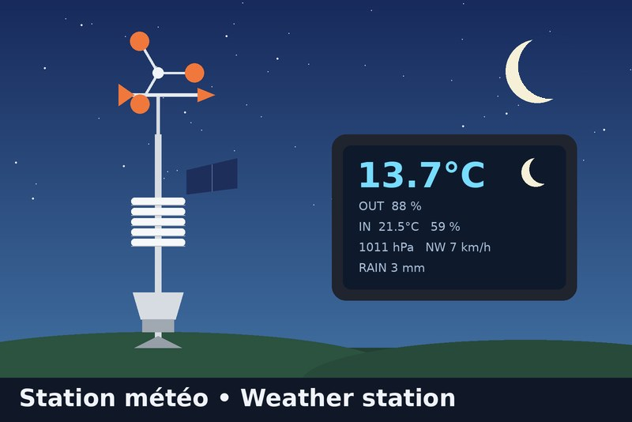

# gladys-bresser-weather-station



External integration for **Gladys Assistant** for the Bresser 7002580 WiFi colour station (5-in-1), plus a moon-phase widget. End-user guide: `docs/en.md` / `docs/fr.md`.

Two data sources (setting `mode`): **Wunderground API** (the main container polls api.weather.com; no indoor values) or **local relay** (the station's own upload, full data).

```
Relay mode: Bresser console --HTTP GET (Weather Underground protocol)--> Pi (dnsmasq + nginx)
                                                              |-> real Weather Underground
                                                              '-> companion container "wu-receiver" (src/receiver.js)
                                                                    -> Gladys (SDK publishStates)
```

- `src/wunderground.js` parses + converts the query (imperial -> metric), ignoring `ID`/`PASSWORD`.
- `src/server.js` HTTP endpoint; never logs URLs; publishes only changed values.
- `src/device.js` feature declarations shared by both containers.
- `src/wuapi.js` + `src/publisher.js` API mode and shared change-only publishing.
- `src/index.js` main container: discovery, moon widget, applies the mode (polls, or starts the `wu-receiver` companion).
- `relay/` network relay configuration.

Test locally: `curl "http://localhost:8080/weatherstation/updateweatherstation.php?tempf=56.6&humidity=88&baromin=29.85"`.
Validate before release: `npx github:GladysAssistant/integration-store .`
